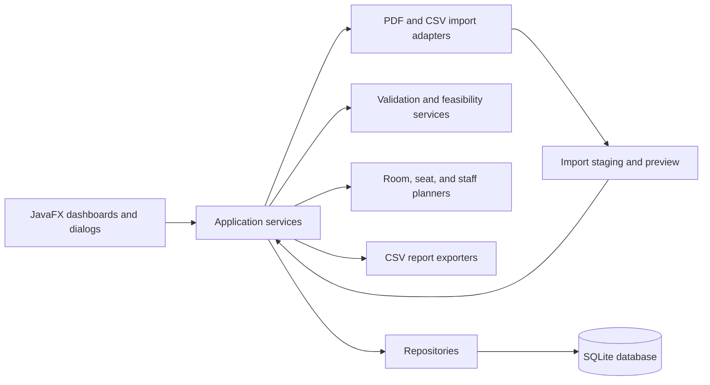

# Architecture

## 1. System shape

The first release is a local Java desktop application. JavaFX presents workflows and dashboards; application services implement import, validation, planning, and reporting; repositories persist normalized records to SQLite. PDF and CSV files enter through adapters and are converted into validated domain records before persistence.



## 2. Module boundaries

The starter project keeps the package tree shallow. Add a package when a feature needs it; do not create empty package folders in advance.

```text
src/main/java/
  app/              startup and dependency wiring
  ui/               JavaFX frames, panels, table models, dialogs
  persistence/      JDBC repositories, schema migrations, transaction helpers
```

As the application grows, add only the needed feature packages (for example `planning/` or `importexport/`) directly under `src/main/java`. JavaFX UI code calls application services; it does not contain SQL, parse PDFs, or implement seating logic. Planner services receive immutable input snapshots and return proposed assignments plus diagnostics. Repositories handle persistence and transaction boundaries.

## 3. Main flows

### 3.0 Dashboard-first implementation and master-data setup

Implement the master-data dashboards in this order: invigilator → room → student. The supplied synthetic CSVs exercise these screens before date-sheet intake is implemented. Staff, room, student, and enrollment records can exist without an exam event; fields that depend on a schedule (session availability, attendance, course-to-session reconciliation, or assignments) remain empty/pending until an event exists. After those dashboards are usable, implement event/date-sheet and candidate-count import. For an actual event, its schedule and demand are reviewed before the administrator selects rooms and staff for planning.

### 3.1 Event intake and schedule import

1. The administrator creates/selects an event and imports the date sheet. Parse the tabular date sheet as primary and optionally compare the compact matrix version.
2. Ask once for the shared exam duration. Derive each session end as that session's start plus the duration. Show the derived schedule for review; do not request separate end times or a handover buffer per event.
3. Import the course/student-count sheet and match course demand to date-sheet sessions by date, start time, and course code.
4. Optionally import named students and student-course registrations. If omitted, preserve anonymous course demand and do not create student records.
5. A background worker extracts PDF text with PDFBox; separate parsers create typed staged rows with source page/row metadata.
6. Validators find duplicates, unmatched courses, malformed dates/counts, invalid course references, and total mismatches. When a named roster is present, reconcile registrations and check student session clashes.
7. Show staged data and derived timing in a preview; allow corrections, then commit accepted records in a repository transaction.
8. Open the room dashboard with the saved provisional room inventory. The administrator reviews/selects rooms and corrects inventory before plan generation.
9. Staff and room master records are already manageable in their dashboards. Once sessions exist, configure session availability, course exclusions, and attendance, then select eligible staff for each room.

Imported documents are untrusted data. Parsing must not execute embedded content. If extraction order or layout is ambiguous, preserve raw text/page context for review instead of guessing silently.

### 3.2 CSV dashboard import

Each dashboard shares an import pipeline: inspect headers, map fields, parse to staging rows, validate keys/references, show add/update/skip/error counts, then commit selected changes transactionally. Exports use stable IDs and round-trip-compatible headers.

The maintained fixtures are documented in `data/demo/README.md`. `exam_sessions.csv` describes the assessment period and maps to the application's `exam_event`; `exam_events.csv` has one scheduled course paper per row, where date/start/slot identify a dated exam session. `event_id` is a source row key, not the application event ID. Each row includes its aggregate `candidate_count` and source page/row references. `course_demand_source.csv` preserves the extracted total and course counts for preview reconciliation. `enrollments.csv.session_id` is the assessment-period key, so registrations attach to the event and course; `course_student_list.csv` is retained as a demo reference/export view and has no separate import path. The generated roster uses synthetic identities and matches the 2026 course counts. The separate 2022 parser sample is not part of this event. `end_time` is intentionally blank because the administrator provides one shared duration; derive and preview every end time from that duration. `students.csv`, `rooms.csv`, and `invigilators.csv` populate their dashboards. Import explicit teaching relationships from `invigilator_course_assignments.csv`; do not infer them from department. Keep IDs as strings, preserve `data_label`, and record batch provenance. The fixture's `max_duties` is not an operational policy.

### 3.3 Plan generation

1. Load an immutable snapshot of selected sessions, course demand, rooms, availability, seat geometry, the global handover setting, optional enrollments, and the staff/exclusion/availability/attendance data already managed by the invigilator dashboard. If staff data is incomplete, expose the missing setup state in preflight.
2. Run preflight hard checks, calculate usable capacity, and calculate fixed staffing demand from room capacity.
3. Allocate course demand to blocks and rooms, scoring course cohesion as a preference.
4. Place candidates into usable seats, reducing orthogonal same-course adjacency. Diagonal adjacency is allowed.
5. When staff data is available, assign eligible staff per room/session; earlier previews show the requirement and leave assignments pending.
6. Run `PlanValidator` against the same resource snapshot to check demand, assignment uniqueness, capacity, availability, student clashes, and staff eligibility. Existing planner diagnostics identify soft seat adjacency and block splits.
7. Save a draft plan version and diagnostics in one transaction. Finalization requires all required invigilator assignments to pass validation.
8. List saved plan versions for the selected event and reopen persisted seating charts. Show a stale warning when the event revision has changed.
9. Finalize only a current draft that passes independent validation; require acknowledgement for remaining resource/eligibility warnings and record the administrator and timestamp.
10. Present results and progress summary to the UI.

For a current saved plan, the course-by-block check groups assigned seats by session, course, and building; it compares the sum with the source course count and reports splits or count mismatches. Stale plans do not offer this check because the source counts may have changed. The same rows can be exported to CSV.

### 3.4 Manual edits and finalization

Candidate seat moves and invigilator replacements save as a new plan version with a concise change summary. The saved draft is revalidated before it can be finalized. Finalization locks its seat assignments and records the administrator and timestamp. Display snapshots preserve the session, room, and seat chart values; later generations create a new version and retain the old finalized version. Do not create a general-purpose audit log for every CRUD edit in the first release.

## 4. Planning approach

Start with an explainable heuristic rather than a general-purpose optimization framework:

- **Room allocation:** sort course groups by descending demand; choose a block/room that has remaining capacity while minimizing course splits and respecting availability. Keep a course in one block if feasible.
- **Seat placement:** enumerate usable seats; place candidates using a deterministic ordering and choose the seat with the lowest added orthogonal same-course conflicts. Use deterministic tie-breaking. Keep the initial algorithm to one greedy pass; defer local-search swaps until the baseline is measured.
- **Staff assignment:** require three invigilators when the room's configured exam-usable capacity is greater than 100 seats, otherwise require two. Exclude unavailable staff, staff already assigned to a conflicting session, and staff associated with any course in that room. Assign eligible staff using a deterministic order.
- **Diagnostics:** explain violations as structured records, not log-only messages.

Keep the planner behind interfaces so heuristics can be replaced or supplemented later. A score may rank soft preferences, but hard constraints must be independently checked and must never be represented only by a large penalty.

See [Seating Assignment Algorithm](SEATING_ALGORITHM.md) for the detailed hard-valid predicate, block/room selection, greedy seat score, deterministic tie-breaking, diagnostics, and acceptance examples.

## 5. Concurrency and responsiveness

- Start JavaFX on the JavaFX Application Thread.
- Keep component/model updates on the JavaFX Application Thread.
- Run PDF extraction, CSV import/export, database-heavy work, and plan generation in a background worker.
- Report progress through a worker-to-UI progress channel.
- Use one database transaction for each accepted import batch and plan-version save.
- Avoid holding a database write transaction while the optimizer runs; plan against a snapshot, then persist the result.
- Store a source-data revision with the planning snapshot. Before saving a generated draft, compare that revision with the current event revision. If it changed, discard the result as stale and require regeneration.
- Increment the event source-data revision when schedule counts, session timing, room inventory/availability, staff eligibility/availability, or planning policy changes.

## 6. Persistence and configuration

SQLite is embedded and local. Buildings, room counts/capacities, room codes, staff identities, course exclusions, and seating settings are records, not Java constants. The initial staffing calculation is the fixed code exception: `capacity > 100 ? 3 : 2`. The shared handover buffer is a system-managed setting initialized to 30 minutes and is not part of event intake. Schema changes use ordered migrations. Seed/configuration data may be edited and replaced without recompiling.

The user-facing term **block** means the configured building group in the first release. Rooms belong directly to a building/block; no separate block hierarchy is modeled.

Exam-centre/reporting groups are labels on room allocations, separate from physical buildings. A centre may include rooms in more than one building and is used for centre-wise exports and filters.

Use JDBC with prepared statements. Keep repositories small and domain-oriented; do not introduce an ORM unless project requirements change materially.

## 7. Error handling

- **Import error:** identify file, page/row, field, and repair path.
- **Validation blocker:** identify hard rule and affected session/room/record; prevent finalization.
- **Preference violation:** show affected assignments and allow an informed decision.
- **Unexpected exception:** show a user-safe reference ID; log stack trace and contextual IDs without unnecessary personal information.
- **Persistence error:** roll back the transaction and keep the prior saved state intact.

## 8. Deployment boundary

Initial deployment is a local desktop app with one active writer. Exports use a visible save location; database backup and restore are deferred in the current release. If simultaneous multi-computer editing becomes a requirement, introduce a server API and client-server database as a separate architecture change; do not share one SQLite file over a network drive.
