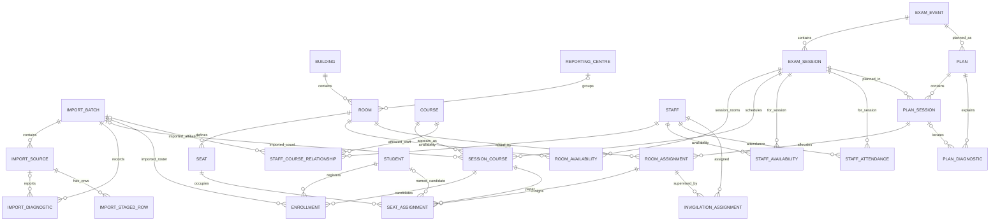

# Logical Data Model

This document describes logical records and relationships. The first concrete SQLite schema and its foreign-key/index definitions are in [`V001__initial_schema.sql`](../db/migrations/V001__initial_schema.sql); the migration/import procedure is in [`DATABASE_SETUP.md`](DATABASE_SETUP.md). Institutional inventory values are data, not constants in planner code; the initial staffing threshold is the specified fixed-rule exception.

## 1. Entity map

`APPLICATION_SETTING` is intentionally standalone. `PLAN_SESSION` represents a particular schedule sitting inside one versioned plan, so the same `EXAM_SESSION` can appear in multiple plan versions. A `SEAT_ASSIGNMENT` has either a `STUDENT` foreign key or an anonymous candidate number, never both. Composite foreign keys also ensure its room assignment, plan session, seat, and course paper refer to the same room/session.

## 2. Schedule and import tables

### `exam_event`

- `id` primary key
- `name`, `event_code`, `academic_period`, optional description
- required shared exam duration in minutes; applies to every session in the event
- `status` such as draft, active, archived
- `created_at`, `updated_at`

### `exam_session`

- `id` primary key
- `event_id` foreign key
- `session_date`, required `start_time`, required `end_time`
- session label and status
- unique event/date/start-time key unless institution rules require another key

When a date sheet contains only a start time, import asks once for the event's shared duration and derives every end time as `start_time + duration`. The preview shows all derived intervals before confirmation. Two sessions on the same date conflict for room/staff reuse when their intervals `[start, end + global_handover_buffer)` intersect; sessions on different dates do not overlap. The global handover buffer is system-managed and defaults to 30 minutes; it is not requested in event intake.

### `course`

- `id` primary key
- unique normalized `course_code`
- `course_name`
- active status

### `session_course`

Represents a course paper scheduled in a session.

- `id` primary key
- `session_id`, `course_id` foreign keys
- `candidate_count`
- count provenance/status: imported, corrected, registration-derived, confirmed
- optional source page/row metadata
- unique session/course pair

### `import_batch` and `import_source`

- batch identity, event, status, creator, timestamps
- source document type, filename, checksum, import location, parse result
- staged/accepted/rejected row counts and validation diagnostics
- avoid storing full PDF binary data in a relational row unless deployment explicitly needs it

#### Supplied synthetic CSV fixtures

The maintained `data/demo` fixtures contain 10,000 synthetic students; 73,616 synthetic registered course rows; 386 scheduled course papers across 41 dated/time slots; 500 synthetic staff; 1,000 synthetic staff/course teaching relationships; and 230 provisional rooms with 9,280 estimated seats. See `data/demo/README.md` for provenance and import sequence. IDs are strings and person data are invented. The 2026 course-level candidate counts are extracted from the supplied count PDF; the roster rows use synthetic IDs, are sized to those counts, and are not a Thapar roster. The separate 2022 parser fixture contains 25 course codes only and must not be joined to the 2026 assessment period.

`exam_sessions.csv.session_id` is the assessment-period key and maps to the application's `exam_event`; preserve the source key in import metadata. `exam_events.csv` contains scheduled course papers. Its `event_id` is a source-row key; date/start time and `slot_id` identify the dated `exam_session`, and `course_code` maps to `course`. `candidate_count` holds the PDF-derived count. The `end_time` is blank because the application asks once for a shared duration and derives ends; do not interpret a missing value as zero-duration. `course_demand_source.csv` retains source page, row, total, and filename metadata for count reconciliation. `enrollments.csv.session_id` refers to the whole assessment period, not an individual time slot. `course_student_list.csv` is an optional flat roster interchange view; it duplicates the logical rows represented in `enrollments.csv`, so an import batch must choose one to avoid duplicate registrations. `invigilator_course_assignments.csv` contains fabricated explicit teaching relationships; the teaching filter must use these rows, not infer from department. `max_duties=6` remains a sample field and is not an adopted workload policy. Room rows are assumption-based dashboard records and remain visibly unverified; historical report examples do not verify current capacities.

## 3. Room inventory tables

### `building`

- stable ID, building code/name, active status, optional campus/floor metadata
- In the first release, the administrator-facing term "block" is a building group; no separate block table is needed.
- Provisional inventory is stored as editable database seed rows: G/B/C/D/E/F each have 3 floors with 12 rooms per floor at estimated 30-seat exam capacity and 5×6 starter grids; LT has 4 floors with 2 rooms per floor at estimated 200-seat exam capacity and 10×20 starter grids; TAN has 3 floors with 2 rooms per floor at estimated 200-seat capacity and 10×20 starter grids.
- The seed contains 230 rooms and 9,280 estimated seats in total. If all rooms were assigned concurrently, the fixed staffing rule would require up to 474 staff; actual room use is limited by demand and eligible staff availability.
- The room dashboard marks seed capacities and starter grid geometry as unverified. Placeholder room codes remain editable until official room codes/layouts are confirmed.

### `room`

- stable ID, building foreign key, room code, floor, active status
- layout representation reference or row/column dimensions
- physical layout size and configured exam-usable capacity as separate values
- capacity source/status, such as verified, estimated, or manually overridden
- optional room type and notes
- provisional/verified source status and optional reporting-centre label
- unique building/room-code key

### `seat`

- stable ID, room foreign key, row/column or seat label
- status: usable, blocked, or reserved
- optional reason
- unique room/row/column key

### `room_availability`

- room, session, available flag, reason, and source of change
- default availability is configurable; do not assume every room is available for every event

### `planning_policy`

Stores seating adjacency policy and soft-preference weights. The initial staffing calculation is fixed in planner code: configured exam-usable room capacity greater than 100 requires 3 invigilators; capacity of 100 or less requires 2.

### `application_setting`

- Stores global operational settings including the same-day room/staff handover buffer, initialized to 30 minutes.
- The setting is not requested during event import; the overlap validator applies it consistently to rooms and invigilators.

For planning, use the configured exam-usable capacity. When seat records exist, the effective capacity is the smaller of configured exam-usable capacity and usable seat count. Estimated capacity may be used for drafts with a warning; finalization requires explicit acknowledgment.

## 4. Student and registration tables

These tables are optional for aggregate count-based planning.

### `student`

- institutional student ID as stable key
- display fields required for seating/attendance output
- program/cohort/semester/section where needed for filtering
- active status
- collect only necessary personal attributes

### `enrollment`

- student and `session_course` foreign keys; because schedule intake happens before optional roster matching, the registration points to the exact scheduled paper. Event and course are derived through `session_course` and `exam_session`, avoiding duplicate event/course columns on each enrollment
- registration status and source/import batch
- unique student/session-course key

The CSV's assessment-period and course-code fields are resolved to exactly one scheduled `session_course` during import. A missing or multiply scheduled course-to-sitting match requires review; do not duplicate or arbitrarily assign the student.

Student-level registrations enable named seating, individual conflict validation, and continuity preferences. When no student row exists, do not create fictional identities in this table. Anonymous count-based candidates belong in plan assignment records and are identified as anonymous.

## 5. Staff tables

### `staff`

- stable staff ID, display name, department/team if required, active status

### `staff_course_exclusion` or `staff_course_assignment`

- staff/course relationship describing which course papers the staff member must not invigilate
- supports the rule that a staff member cannot supervise a room containing a course they teach or are excluded from

### `staff_availability`

- staff, session, available/unavailable status, optional reason
- Availability is per whole session in the first release.

### `staff_attendance`

- staff, session, present/absent status, timestamp, optional absence reason
- attendance is separate from advance availability

## 6. Plan tables

### `plan`

- ID, event, version number, status (draft, reviewed, finalized, superseded)
- generation configuration snapshot/reference, source-data revision, concise change summary, created/finalized timestamps
- optional deterministic seed and planner version

### `plan_session`

- plan/session link with status and session-level summary

### `room_assignment`

- plan-session, room, candidate count, optional reporting-centre label, required invigilator count, status
- required invigilator count is calculated in code from configured exam-usable capacity: 3 when capacity >100; otherwise 2
- unique plan-session/room assignment

### `seat_assignment`

- room assignment, seat, session-course
- optional student ID for named mode
- anonymous candidate sequence for count mode
- assignment origin (generated/manual), lock status, change metadata
- unique room assignment/seat
- enforce that either a student ID or anonymous candidate key is present, not both

### `invigilation_assignment`

- room assignment, staff, role, assignment status, source
- unique room assignment/staff pair
- validate a staff member is not assigned to overlapping sessions

### `plan_diagnostic`

- plan/session, diagnostic code, severity, hard/soft classification
- affected building/room/seat/course/student/staff references where present
- observed/required values, explanation, suggested action
- resolution status and reviewer notes

## 7. Key integrity rules

- Candidate count is a non-negative integer.
- Course code is normalized for joins while original source spelling can be retained for import traceability.
- A room cannot be assigned to sessions whose same-date buffered intervals intersect.
- The same-day buffer is applied from the global application setting, not imported or entered per event.
- Invigilator team size is 3 when configured exam-usable capacity is greater than 100 and 2 otherwise.
- A seat cannot be assigned to two candidates in the same plan/session.
- A named student cannot receive two seat assignments in one session.
- A staff member cannot be assigned to sessions whose same-date buffered intervals intersect.
- A room's computed usable seats and configured capacity must reconcile or produce a reviewed warning.
- Finalized plans are immutable; amendments create a new version.
- A plan generated from an older source-data revision cannot be committed or finalized.
- Imports are idempotent using stable keys and import-batch metadata; conflicting updates require review.
- Count-based plans contain no personal student data. An administrator can manually purge/anonymize event-linked student/staff identifiers and named assignments; automatic deletion is out of scope until a retention interval is agreed.
